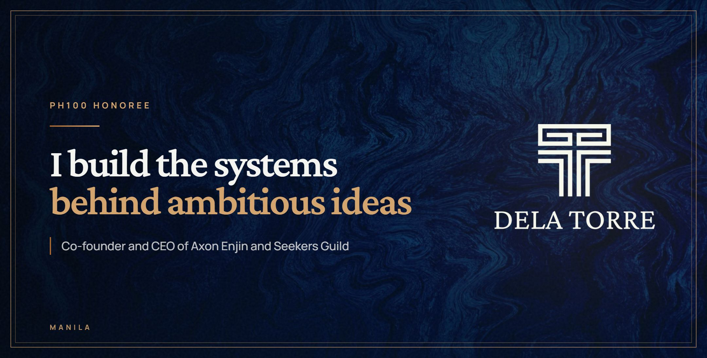
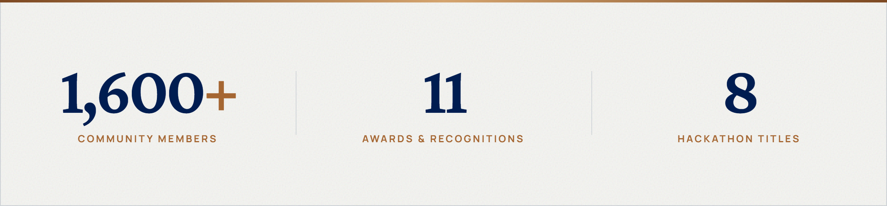
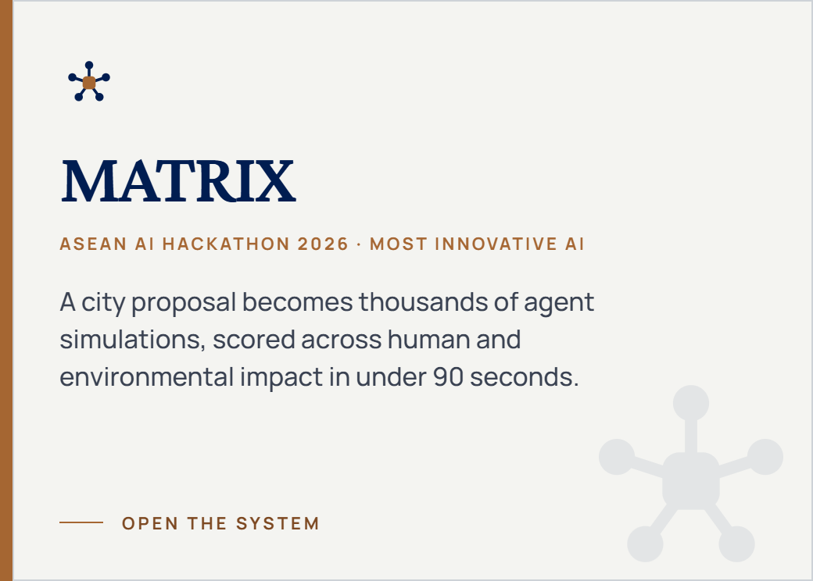
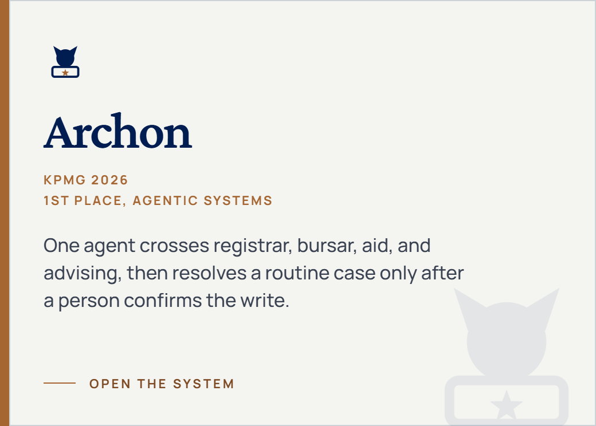
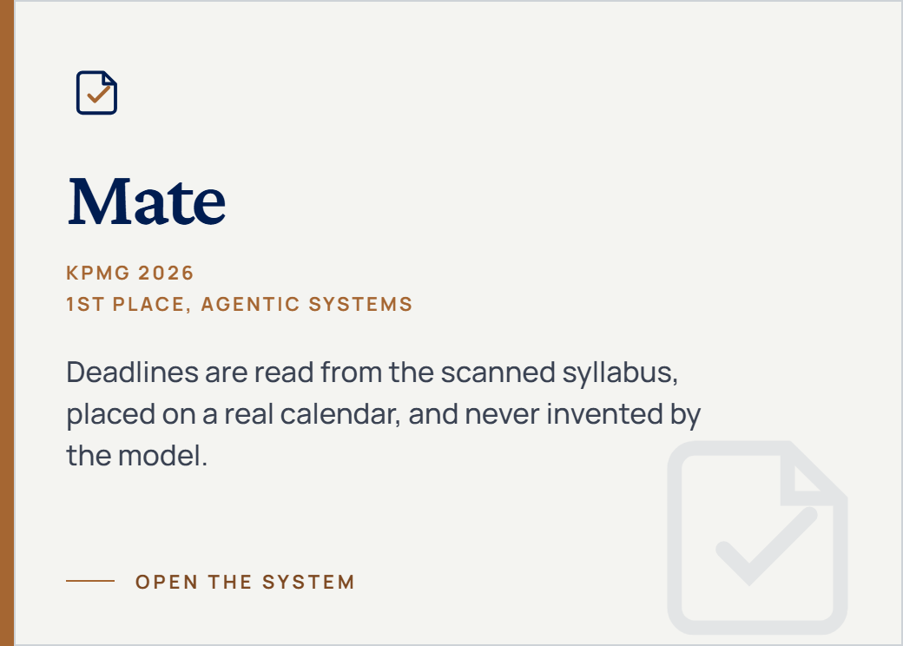
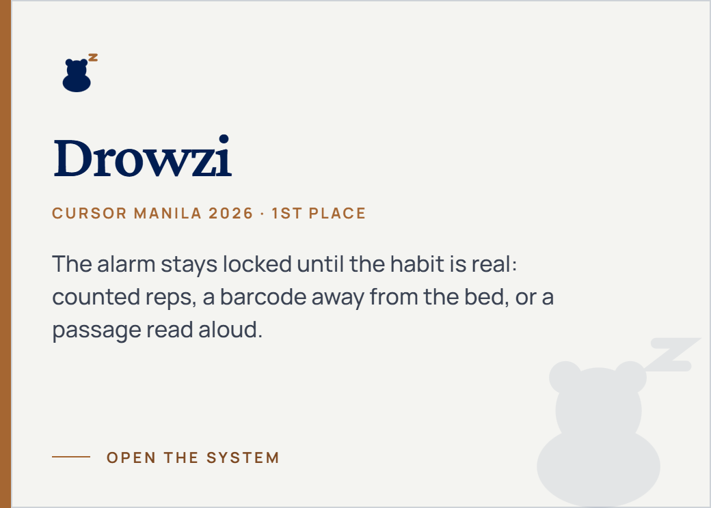
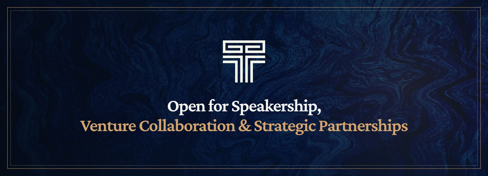

  

  
  
  
  
  

I'm Carlos Jerico Dela Torre, a computer engineering student at the Polytechnic University of the Philippines. I build the systems behind ambitious ideas, and I do that work in public with other people.

[StellarPH](https://stellarph.io/programs/ph100/2026) named me a PH100 Honoree for 2026, one of 100 people under 30 in the Philippines. My name is on that list because of the people I build with, especially [Seekers Guild](https://www.facebook.com/seekersguildcommunity).

  

## Now

**Co-Founder and CEO, [Axon Enjin](https://www.facebook.com/axon.enjin)** 
A software and automation studio. Custom platforms and internal tools for startups and multi-branch companies.

**Co-Founder and CEO, [Seekers Guild](https://www.facebook.com/seekersguildcommunity)** 
The community I founded for builders who are still looking for a room. This is the work the PH100 recognition sits beside.

**Technology Executive Consultant** 
[GDG on Campus PUP](https://www.facebook.com/gdg.pupmnl), [Microsoft Campus Club PUP](https://www.linkedin.com/company/microsoft-campus-club-pup), and Microsoft Student Community Philippines.

**AI Product and Strategy Manager, ED3N Ventures** 
Part-time. Reference AI products, and workshops people leave able to ship.

## Selected systems

Four systems from this year. The rest of the selected work is on the [portfolio](https://delatorre.axonenjin.com).

  
  

  
  

Public code: [MATRIX](https://github.com/delatorrecj/matrix) and [Stella](https://github.com/delatorrecj/stellar)

## Recognition

Nine hackathon titles. The latest is 2nd runner-up at [Camp Run 2026](https://www.linkedin.com/posts/keanuagustin31_hermesagent-agenticai-hackathon-activity-7517910200134074368-rICh), with Axon Enjin.

- [PH100 Honoree](https://stellarph.io/programs/ph100/2026), StellarPH 2026
- [Most Innovative AI](https://www.linkedin.com/posts/delatorrecj_aseanaihackathon-matrix-mostinnovativeai-ugcPost-7497339759036407809-pU6v/), ASEAN AI Hackathon 2026
- [1st place, Agentic Systems](https://www.linkedin.com/posts/delatorrecj_another-milestone-for-axon-enjin-and-the-ugcPost-7479125970096910336-45B1/), KPMG 2026
- [1st place](https://www.linkedin.com/feed/update/urn:li:activity:7463969640247910400/), Cursor Manila 2026
- [Champion](https://www.linkedin.com/posts/delatorrecj_stellar-soroban-web3ph-activity-7454951396904292352-v7Y2), Build on Stellar Bootcamp 2026
- [Champion](https://www.linkedin.com/posts/delatorrecj_bpidatawave2025-bemorewithbpi-innovation-activity-7398251211604422656-qzZy), BPI DataWave 2025

  

  
  
  
  
  

